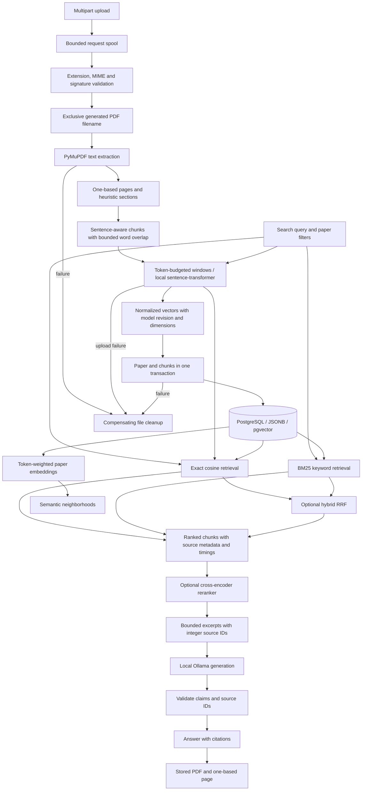

# ScholarGraph architecture

`app.api` validates the HTTP contract. `app.services` coordinates file/database work.
`app.ingestion` contains independently testable parsing, chunking, and storage logic.
`app.retrieval` contains the embedding contract, sentence-transformer implementation,
exact pgvector retrieval, BM25, and RRF fusion. `app.models` defines persistence; `app.schemas` prevents
internal paths/raw vectors from leaking into responses. `app.db` supplies sessions.
The app factory accepts injected sessions and an embedding provider for tests;
production requires PostgreSQL and uses actual local sentence-transformer inference.

Alembic owns schema changes. Migration 0001 installs pgvector in public and creates
papers/chunks with source metadata, constraints, lookup indexes, and cascading deletion.
Migration 0002 adds model revision/dimension metadata and checks their consistency.
The vector column is dimensionless to permit deliberate model changes; retrieval
strictly filters model spaces. No approximate similarity index is added in Milestone 2.

Extraction uses PDF title/author metadata where available, then title heuristics and
filename fallback. Recognized headings carry across pages. Chunking preserves page and
section boundaries; the embedding adapter then handles actual tokenizer limits separately.
See [retrieval design](retrieval.md) for window pooling, filtering, indexing, and tradeoffs.

Ingestion generates all embeddings before committing the paper and chunks, and cleans
up files on failures. An explicit indexing command backfills existing papers one at a time
while preserving text and IDs. Deletion persists intent, unlinks the file, and deletes rows.
There is no distributed filesystem/database transaction; crash recovery and process-isolated
PDF parsing remain future work. The upload root must be application-controlled.

BM25 and dense retrieval now implement a shared Retriever contract. The search service
selects either method or fuses both candidate lists with RRF. See retrieval.md for details.

## Retrieval and reranking

Dense search measures cosine similarity between normalized query and chunk vectors
in the same model space. BM25 finds lexical matches within the selected papers.
RRF combines their ranks so differences between the two score scales do not
determine which retriever dominates. Candidate limits bound fusion and reranking.
Exact vector search and per-query BM25 statistics keep the current implementation
inspectable for small collections. Larger libraries need recall and latency measurements
before choosing approximate vector indexes or persistent lexical indexes.

The optional cross-encoder scores query/passage pairs after candidate retrieval and
before final truncation. It can improve ordering when a passage's relationship to the
question depends on both texts. It adds local inference cost and requires separate
weights. Model-load errors are returned to callers. The real-model comparison remains
pending. Details and score semantics are in [retrieval](retrieval.md).

## Generation and citation mapping

The chat service requests extra retrieval candidates, removes duplicate text and
known repeated metadata titles, then loads authoritative chunk text. At most the
requested number of excerpts are included, with 4,000 characters per passage and
16,000 characters overall. Each supplied excerpt receives an integer source ID.

The Ollama provider returns structured claims and source IDs. The application checks
their shape and membership, assembles the answer, and maps each citation to stored
paper, chunk, page and section metadata. The interface opens an evidence dialog and
the corresponding PDF page. Empty evidence produces an insufficient-evidence response.
The generator can also abstain. A valid source ID establishes provenance, while the
reader must still judge whether its passage supports the claim.

## Comparison

Each request compares two to four selected ready papers on one dimension. Retrieval
is scoped independently to each paper, and the interface accumulates rows for a
fixed selection. Methodology and findings use conservative extraction of sentences
from retrieved evidence. Other dimensions use the answer provider. Individual cells
can report insufficient evidence or a provider error. This allows the reader to
inspect gaps alongside cited statements.

## Graph generation

The graph service pools each paper's complete compatible chunk vectors using token
weights, then normalizes the result. Cosine similarity determines semantic edges.
The overview applies a threshold, deterministic ordering, a degree cap and a bounded
recent-paper window. A focused query ranks that paper's direct neighbors independently.
These edges describe content similarity. Bibliographic citation extraction remains
future work.

GET endpoints compute neighborhoods from current stored vectors without model
inference. The rebuild endpoint saves a default-window snapshot transactionally.
Migration 0003 adds research metadata and edge storage. The frontend renders the
network with Cytoscape.js and provides a keyboard-accessible neighbor list.

## Evaluation and deployment

The evaluation scripts upload original synthetic PDFs into a temporary SQLite
library and resolve stable passage labels to each run's generated identifiers.
They compute precision, recall, reciprocal rank and normalized discounted cumulative
gain. Generated-answer reports retain actual evidence and claims for explicit review.
Latency reports expose embedding, retrieval, reranking, generation and total request
time. See [evaluation methods and results](evaluation.md).

Compose runs PostgreSQL/pgvector, FastAPI and a standalone Next.js frontend. Named
volumes persist database rows, PDFs and model weights. The backend applies migrations
and becomes healthy after a successful catalog query. The frontend starts after
backend health succeeds and proxies API calls over the Compose network. Ollama runs
on the host in the verified local setup. See [Docker operations](milestone-11.md).

GitHub Actions tests Python, the frontend and the complete Docker startup/restart
path. Real generation quality remains a separate measured concern. See
[CI checks](milestone-12.md).
